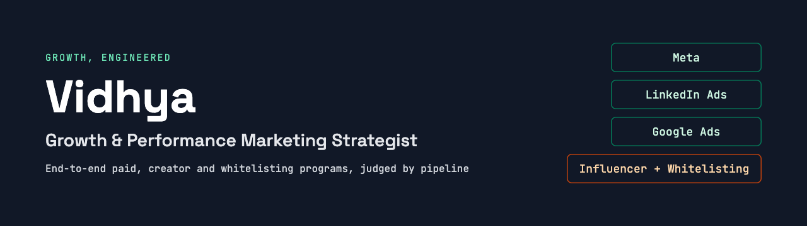

I run paid ads, influencer marketing and whitelisting for B2B tech and consumer brands, in-house and client-side: from budget plan to reporting. I build Claude agents into the workflow so analysis and reporting take minutes, not hours.

These repos are the systems I actually use: **playbooks, templates, SOPs and test notes.**

---

## 🧭 How I operate

| Principle | In practice |
|---|---|
| **Qualified leads over CPL** | A cheap lead that never books a call is waste. I report cost per qualified lead and cost per meeting alongside CPL. |
| **Targeting starts with the ICP** | Account and contact lists built in Apollo and Firmable feed LinkedIn matched audiences and Google Customer Match, so spend reaches real buyers. |
| **Kill rules before launch** | Every test ships with a hypothesis, a spend cap and the number that ends it. No zombie campaigns. |
| **Creators are a paid channel** | Influencer content is briefed for ads from day one, with whitelisting rights agreed before anything is filmed. |
| **Separate budgets, one view** | Paid, influencer and whitelisting each have their own budget, but are judged in one pipeline report. |
| **Agents read, humans decide** | My Claude ads agents are read-only. They pull and summarise; budget and launch calls stay with people. |

---

## 🧩 Frameworks in these repos

- **Lead-quality ladder:** CPL → cost per qualified lead → cost per meeting → pipeline.
- **Creative test matrix:** hook × format × creator, with spend caps and kill rules.
- **Whitelisting rights checklist:** usage window, platforms, edits and fees, agreed before the brief.
- **CPL diagnosis tree:** CPL up? Work down the funnel: audience fit, creative and hook, offer, landing page, then lead form.
- **LinkedIn format selection:** document for lead magnets, thought leader for trust, video for reach, single image for offers.
- **Google campaign mix:** Search captures intent, Demand Gen creates it, Performance Max scales across channels, all on shared conversion goals.

---

## 📓 Latest field notes

| Channel | Note | Status |
|---|---|---|
| LinkedIn | **Document ads:** gated B2B lead magnet, lead form setup and targeting by role and company size | ✅ Shipped |
| LinkedIn | **Thought leader ads:** promoting a founder's posts to build trust with decision-makers before the ask | ✅ Shipped |
| LinkedIn | **Sponsored content:** single image and single video ads, matched to funnel stage and offer | ✅ Shipped |
| Meta | **Lead gen and app campaigns:** B2B and consumer, in-house and client-side, with structured creative testing | ✅ Shipped |
| Google | **Search campaign structuring:** intent-based campaigns and ad groups, negatives and conversion goals | ✅ Shipped |
| Google | **Performance Max:** asset groups, audience signals and conversion goals so automation optimises for the right leads | ✅ Shipped |
| Google | **Demand Gen:** image and video creative across YouTube, Discover and Gmail to create demand before search | ✅ Shipped |
| Creator | **Whitelisting:** creator brief, usage rights and partnership ads setup for a consumer app | ✅ Shipped |
| Agents | **Meta reporting agent:** read-only Claude agent for daily ads summaries, with guardrails | ✅ Shipped |

---

## 🤖 Agents

*Built with Claude. Agents read and recommend; a human approves every change.*

| Agent | Job | What it does | Status |
|---|---|---|---|
| Weekly performance agent | Report | Meta, LinkedIn and Google in one Monday summary: what changed, why, and what to do next | ✅ Shipped |
| Budget pacing agent | Monitor | Daily spend against plan for each budget, with early overspend and underspend flags | ✅ Shipped |
| Creative fatigue watcher | Monitor | Flags ads with rising frequency and falling CTR, so creative is refreshed before CPL climbs | ✅ Shipped |
| Tracking QA agent | Monitor | Checks conversions fire, UTMs follow naming rules and lead forms deliver | ✅ Shipped |
| Wasted spend agent | Optimise | Finds campaigns, ad sets and keywords spending without returning leads | ✅ Shipped |
| Creative variation agent | Create | Drafts new hooks, headlines and copy from winning ads, within each format's limits | ✅ Shipped |
| Competitor ad watcher | Create | Weekly scan of competitors in the Meta and LinkedIn ad libraries: new angles, offers and formats | ✅ Shipped |
| Search terms and negatives agent | Optimise | Weekly Google search-term review with negative keyword suggestions, pushed only after approval | 🟠 In progress |
| Client report agent | Report | Turns campaign data into client-ready reports for agency accounts | 🟠 In progress |

---

## 📌 Playbooks

| Repo | What's inside |
|---|---|
| [`whitelisting-playbook`](https://github.com/vidhyaganapathy/whitelisting-playbook) | Run paid ads through creator handles on Meta, end to end · `rights-checklist` `brief` `setup-sop` `test-matrix` |
| [`meta-ads-playbook`](https://github.com/vidhyaganapathy/meta-ads-playbook) | Lead gen and app campaigns: account structure, creative testing, read-only Claude reporting agent · `structure` `creative-tests` `cpl-diagnosis` `agent` |
| [`linkedin-ads-playbook`](https://github.com/vidhyaganapathy/linkedin-ads-playbook) | Every B2B format: document, single image, single video, thought leader and sponsored content · `doc-ads` `single-image` `video` `thought-leader` `targeting` |
| [`google-ads-playbook`](https://github.com/vidhyaganapathy/google-ads-playbook) | Search, Performance Max and Demand Gen: campaign structuring, asset groups and conversion goals · `search` `performance-max` `demand-gen` `conversions` |
| [`influencer-playbook`](https://github.com/vidhyaganapathy/influencer-playbook) | Creator sourcing, vetting and briefs built for paid use · `sourcing` `vetting` `brief` `outreach` |
| [`growth-performance-playbook`](https://github.com/vidhyaganapathy/growth-performance-playbook) | Budget planning, test design and lead-quality reporting across channels · `budget-plan` `test-design` `lead-ladder` `reporting` |

---

## 🧰 Operating stack

| Area | Tools |
|---|---|
| Ads | Meta Ads · LinkedIn Ads · Google Ads |
| Measurement | GA4 · Windsor.ai |
| Audience data | Apollo · Firmable |
| Research | Semrush |
| Agents | Claude, connected via MCP |

**Scope:** Meta · LinkedIn · Google | Paid · Influencer · Whitelisting | B2B tech · Agency · Consumer apps | In-house + client

**Certified:** Google Ads: Search, Display, Video, Measurement, AI-Powered Performance

---

## 🤝 Let's talk growth

[LinkedIn](https://www.linkedin.com/in/vidhya-ganapathy/) · [GitHub](https://github.com/vidhyaganapathy) · 📍 Sydney, Australia
